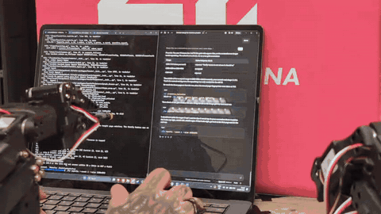
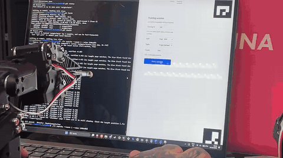
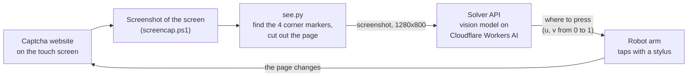
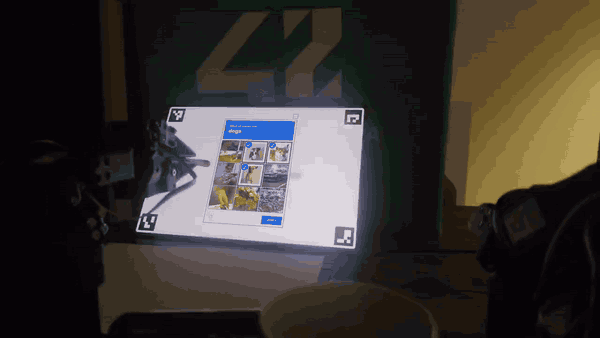
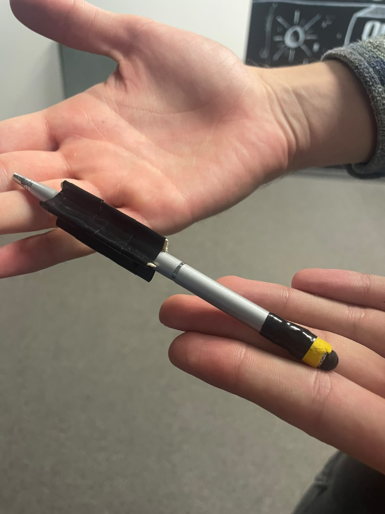
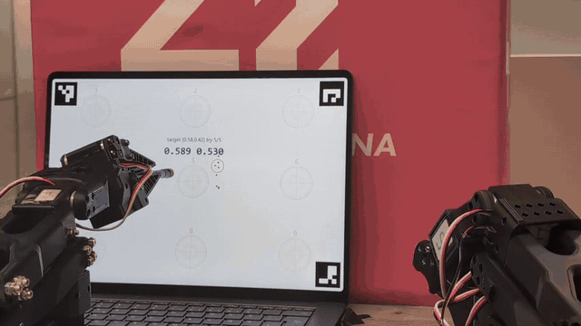
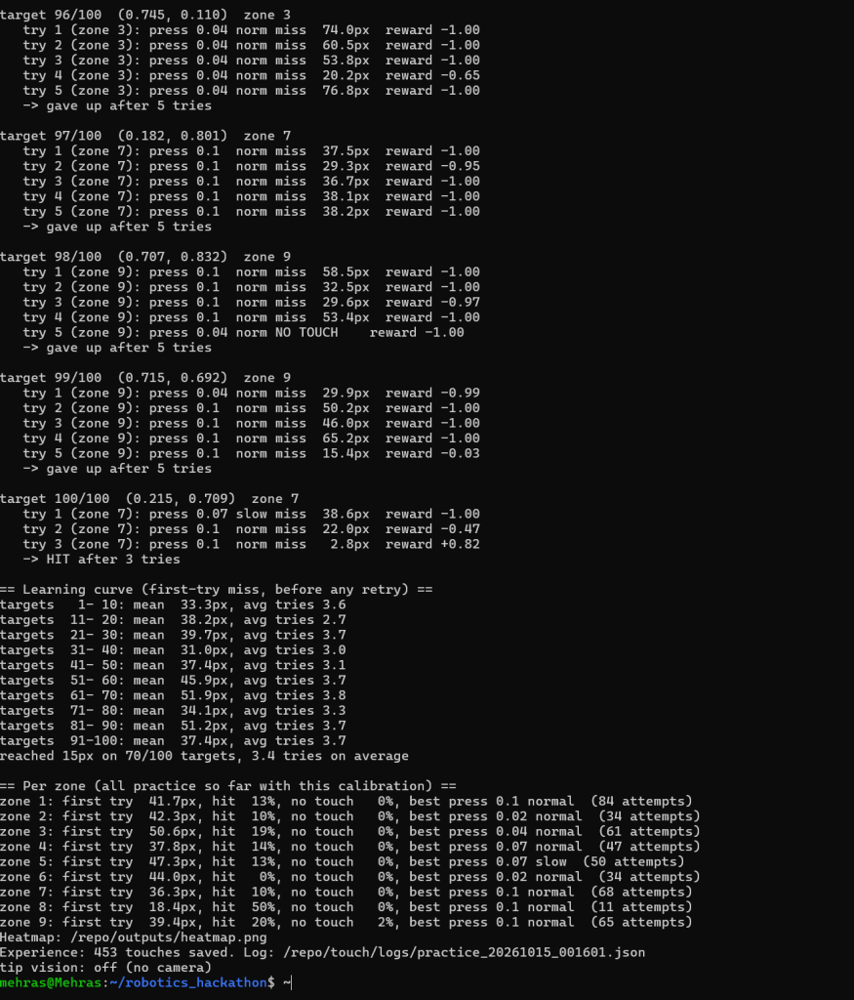
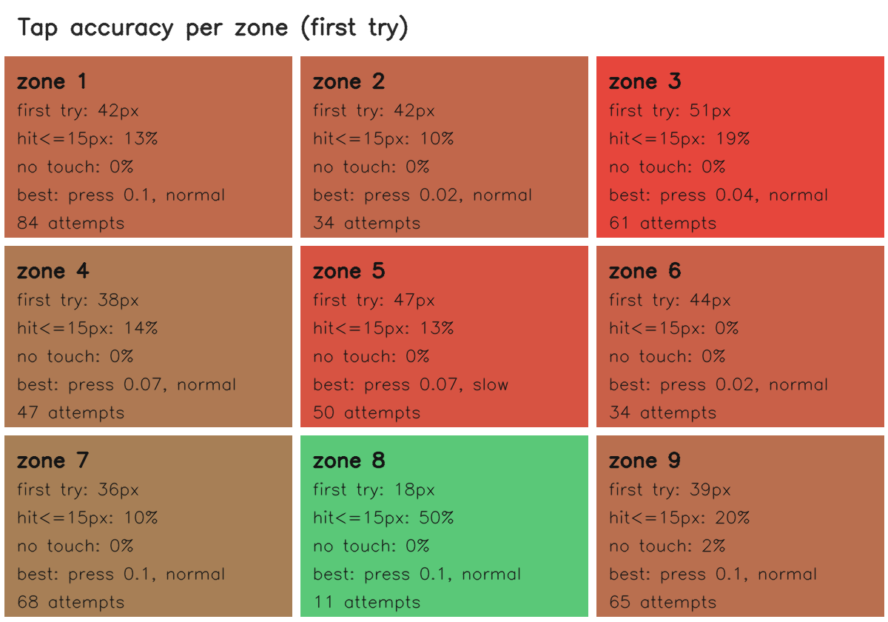
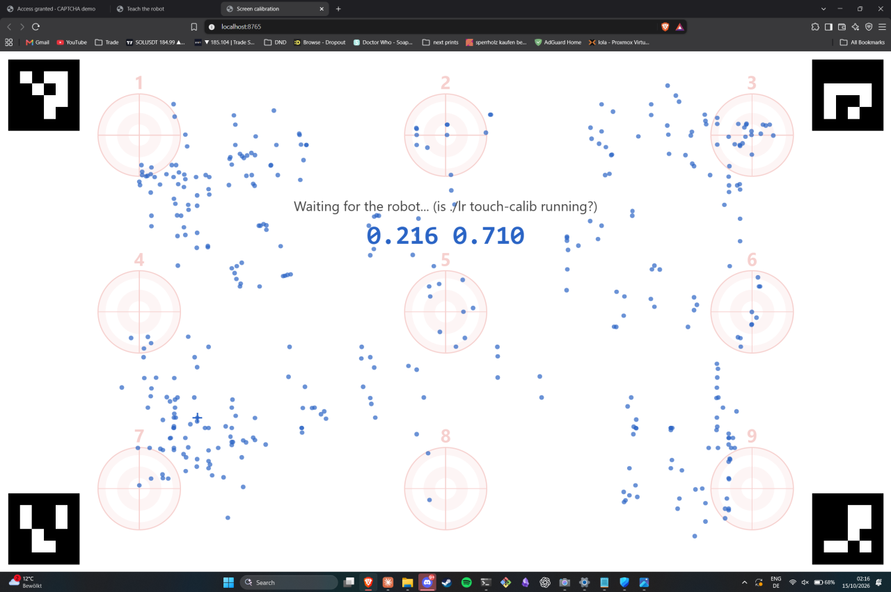
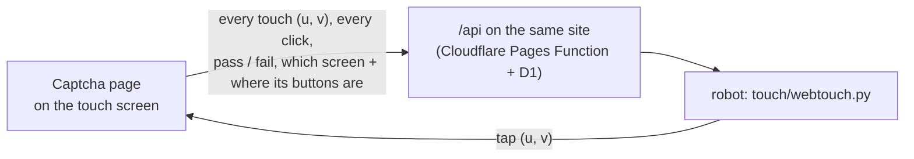

# I assure you, I am not a robot

<p align="center">
  
  
</p>
A robot arm that solves "select all images with…" captchas the way a person would: it **takes a screenshot of the
screen, decides which pictures match, and taps them with a stylus** on the touch screen. In the robot's flow nothing is
clicked by software: the solver only ever sees a screenshot, and the arm only ever touches glass.

### Two ideas carry the project:

- **The arm teaches itself where to press.** You show it the screen once by guiding it to nine dots. After that it
  practises on its own: it taps a spot, the page reports where the touch really landed, and the arm corrects its joint
  angles and tries again until it lands within 15 px. Every touch is kept, and the aim model is refit from all of them. In
  our 100-target run the arm reached 70 targets within 15 px (most of them on the second to fifth try, see [Practice](#2-practice-the-arm-teaches-itself-lr-practice) and
  [the results](#what-the-100-target-run-gave)).
- **It is not tied to captchas.** The arm takes a single instruction: "tap at `(u, v)`", a position from 0 to 1 across
  and down the screen. The captcha solver is just the program that happens to supply those positions here. In principle,
  any application that can say where on the screen to press could drive the arm instead, for example a different vision
  model, a test script for a touch app, or a kiosk. We have only built and tested it with our captcha solver.

We built it at a robotics hackathon (Summit Sprint Hackathon by Austrian Startups, following TU Wien's Robotics Club challenge) with an SO-101 arm and a team of five. The SO-101 is a pair: a follower arm that holds the stylus, and a leader arm moved by hand. The follower copies the leader only while we teach it the screen (calibration), when it solves captchas or practises, it moves on its own.

> **These are our own mock captchas.** The site in [`captcha/`](captcha/) is a demo we made for this project. It is not
> real reCAPTCHA, Turnstile or any other service, and nothing here is meant for anyone else's website.

## Try it
Deployed via Cloudflare:

- **Demo website** (the captchas): https://robot-captcha-demo.pages.dev/
- **Solver** (web UI and API; you enter your own Cloudflare Workers AI account ID and token in its Settings tab):
  https://captchasolver.alvaro-camposmndz.workers.dev/

> **These two links are temporary and will stop working soon.** After that, run both yourself (see [Run it yourself](#run-it-yourself)).

As deployed on 15 Oct 2026, the hosted solver's *test runner* only accepts a different demo host (its `/api/health` lists it), so
on that link use the Solve tab or `POST /api/robot/solve`, and run `captchasolver test` locally to test against the demo site.

## The whole thing in one picture



Every position in the system is a pair **`u, v` from 0 to 1** (u left to right, v top to bottom, measured between the
outer corners of four markers shown on the screen). The screenshot step, the AI and the arm never need to agree on pixels or
millimetres, only on "40% across, 70% down". That pair is also the only thing the arm takes as input, so the solver box
could be swapped for anything else that outputs `u, v`.

## How one captcha gets solved

### 1. The website (`captcha/`)

An [Astro](https://astro.build) site, deployed as static files on Cloudflare Pages.

- `/training/` has the challenge picker: 400 photo puzzles (200 grids, 200 sliders), a train/test split (80/20 by
  default) and sessions of 100 tasks in a row for repeatable runs. We only support solving the grids at the moment.
- A **"Camera markers"** switch draws four black ArUco markers in the page's corners. They tell `see.py` where the page is
  in the screenshot, so tick it before a robot run.
- It is built for a stylus that wobbles: a touch that drags a little neither scrolls the page nor loses the click.

See [`captcha/README.md`](captcha/README.md).

### 2. The screenshot ([`touch/screencap.ps1`](touch/screencap.ps1), [`touch/see.py`](touch/see.py), [`touch/markers.js`](touch/markers.js))

The robot reads the screen from a **screenshot, not a camera**. On the arm's Windows laptop a small PowerShell script,
`touch/screencap.ps1`, saves a screenshot of the whole screen about four times a second to `outputs/screen_live.jpg`.
You start it yourself in its own window and leave it open. With `CAMERA=screen` in `lr.conf`, `./lr` reads that file where
it would otherwise open a camera, and stops with a clear message if the picture is more than 3 seconds old (the capture
isn't running).

The screenshot shows the whole desktop, so the four markers (IDs 0 to 3, one per corner of the page) are used to find the
page: `see.py` cuts the image to the rectangle between them and scales it to a fixed 1280×800 picture, so pixel `(x, y)` is
`u = x / 1280`, `v = y / 800`. Nothing is calibrated, and the page can sit anywhere on the screen.

The same code can read a camera instead (USB or RealSense, a phone running IP Webcam or DroidCam, a URL) for a screen that
is a separate monitor. The demo doesn't use this. We did test it, and it barely worked.

<p align="center">
  
  <br><em>The camera mode works... barely :)</em>
</p>

### 3. The brain ([`captchasolver/`](captchasolver/))

A Python service that turns a screenshot into press positions, using vision models on **Cloudflare Workers AI**
(default: Gemma 4, `@cf/google/gemma-4-26b-a4b-it`):

1. Find the dialog (blue banner, 3×3 grid, Verify) from colour and proportions only. It also copes with camera photos
   (tint, dim light, tilt), though the demo sends clean screenshots, and it **refuses instead of guessing** (`no_dialog`, `layout_inconsistent`, `cropped`): a robot must
   never press from a half-found layout.
2. Read the banner ("bicycles") with the model.
3. Ask the model one yes/no question per tile, all nine in parallel.
4. Answer `POST /api/robot/solve` with the tiles to press, then Verify last:
   `{"ok": true, "target": "bicycles", "presses": [{"seq": 1, "role": "tile", "tile": 1, "x_norm": 0.5, "y_norm": 0.37}, …]}`.
   One error shape for everything (`ok: false, error, detail, retry`) and no rate limit on this endpoint, so a live demo
   never gets throttled. If no tile matches it returns an error rather than pressing Verify on an empty selection.

It also ships a test harness that drives our website with a browser and reports pass/fail per challenge, a model
comparison, and a small web UI. It runs as a Cloudflare Worker plus container. Your own Workers AI token goes into
`lr.conf` (git-ignored) or the UI's Settings tab, and is never stored by the service. Details:
[`captchasolver/README.md`](captchasolver/README.md).

### 4. The arm ([`touch/`](touch/))

A capacitive stylus is fixed in the follower's gripper. The arm knows nothing about captchas; it only knows how to **tap
`(u, v)`**:

<p align="center">
  
  <br><em>The stylus the follower holds.</em>
</p>

- **Calibration (`./lr touch-calib`).** You drive the follower with the leader arm to nine dots on the screen: home, down to
  the dot, back up to home. The page reports the exact spot each touch landed. The arm stores the joint angles of every
  dot **and your whole movement**.
- **The model ([`touch/common.py`](touch/common.py)).** For any `(u, v)` it fits a smooth quadratic surface through the nine
  poses (one per joint) to get the joint angles that touch there, and blends your recorded paths the same way to get a
  path down and back up. Paths are de-shaken, timed with a minimum-jerk profile, and the servos get an acceleration
  limit, so movement is smooth.
- **A tap ([`touch/tap.py`](touch/tap.py)).** Home, then your smoothed path down (slow for the last quarter), a small press,
  wait until the stylus has actually arrived, lift from wherever it really is, home. Going home between taps means the
  stylus never drags across the glass.
- **Practice (`./lr practice`).** The arm corrects its aim from its own attempts, with the page reporting where each
  touch landed. See [Training](#2-practice-the-arm-teaches-itself-lr-practice) below.
- **Safety.** Every joint stays inside the range used in calibration (plus a small margin). A learned correction may differ from the plain
  calibration by at most 8°, and one correction step moves a joint at most 3°. In tests and practice the page reports
  a touch the instant the glass registers it, and the arm stops pressing right then. A motor-load force guard exists
  too, but it is **off by default**: it misread normal arm movement as pushing.

### 5. The loop ([`touch/run_captcha.py`](touch/run_captcha.py), `./lr captcha`)

```
look → which page? → choice card / checkbox: tap the taught spot
                   → image grid: ask the solver → tap the tiles → look again: exactly those tiles selected?
                   → tap only the tiles that differ → Verify once → look until the site answers
```

Rules it never breaks, because **a second tap on a tile un-selects it** and nothing is tapped "just to be sure":

- The solver's tile positions must agree with the dialog the robot finds in its own screenshot, or nothing is tapped.
- Verify is pressed only after two looks at the screen have confirmed the selection, only once, and only if the solver's Verify
  position matches the Verify button the robot sees in its own screenshot.
- A screenshot where the four markers can't be found means "look again" (it gives up after five misses), never "tap anyway".
- "Access granted" is a pass, a red "Incorrect selection" is a fail, and no answer within 30 s is `unknown`, never a fail.

Every run saves its screenshots, the solver's JSON, the plan and the result in `outputs/run/<time>/`.
Only the image grid is handled; the slider needs a drag and Turnstile isn't wired in yet.

## Training

"Training" means several different things in this repo. The demo uses the first two; the last one explains the route we
didn't take.

### 1. Teaching by demonstration: calibration

The nine dots you touch with the leader arm are the arm's only *taught* knowledge. Everything else starts from them.

### 2. Practice: the arm teaches itself (`./lr practice`)

This is the self-training run in the media below. It needs no labels and no human:

1. Pick random target spots on the screen. Zones that were bad before get more practice (the screen is split into 9 zones,
   one per calibration dot).
2. Tap. The page reports where the touch really landed, so the arm knows its miss in pixels.
3. Correct the **joint angles** (not the screen position) using how the model says the joints move per unit of `u` and `v`,
   and tap again, up to 5 tries, until the miss is within the tolerance (15 px by default). Then the next target.
4. After every target the model is refit from everything learned.

<p align="center">
  
  <br><em>The arm training itself with <code>./lr practice</code>: tap, measure, correct, retry.</em>
</p>

What is learned, and where it is stored (`touch/experience.json`, per calibration, git-ignored):

| What | How ([`touch/learner.py`](touch/learner.py)) |
|---|---|
| **Where to aim**: which joints touch `(u, v)` | `LearnedModel`: locally weighted regression over the calibration points *and* every touch so far, nearby touches weighted most. It is clamped to stay within 8° of the calibration fit, so it can't wander. |
| **How deep to press and how fast to come down** | `ZoneBandit`: per zone, 8 options (4 press depths × normal/slow). It mostly picks the best-scoring option and tries a random one 15% of the time. A zone with little data borrows from the others. |
| **How hard each zone is** | `zone_report`: first-try miss, hit rate, no-touch rate per zone, used to give hard zones more practice. |

**The reward** scores every attempt: `1 − miss / tolerance`, so `+1` is perfect, `0` is exactly at the tolerance edge and
anything worse is negative (floor `−1`). It loses 0.3 if the page registered more than one touch (a bounce), 0.2 for a force
stop, and a tap that touched nothing scores `−1`. With two tip cameras a no-touch scores up to `−0.4` when the stylus
stopped close to the glass, so near misses teach more than far ones.

#### What `training_logs.json` looks like

[`media/training_logs.json`](media/training_logs.json) is the log of one 100-target practice run (the same file is committed as
`touch/logs/practice_20261015_001601.json`). It has five top-level parts: `calib_id` (which calibration this belongs to),
`settings`, `results` (one entry per target), `zones` (the bandit's statistics) and `zone_report` (the per-zone summary).
Here is one target from `results`, shortened:

```json
{
  "target": [0.215, 0.709],
  "attempts": [
    { "try": 1, "zone": 7, "press": 0.07, "slow": 0.6, "err_px": 38.6, "reward": -1.0,   "touches": 4 },
    { "try": 2, "zone": 7, "press": 0.1,  "slow": 1.0, "err_px": 22.0, "reward": -0.47,  "touches": 1 },
    { "try": 3, "zone": 7, "press": 0.1,  "slow": 1.0, "err_px": 2.8,  "reward": 0.82,   "touches": 1 }
  ],
  "success": true
}
```

- `target` is `[u, v]`: 21.5% from the left edge, 70.9% from the top.
- `zone` is which of the 9 screen zones that spot belongs to (numbered row by row, 1 top-left to 9 bottom-right).
- `press` is how far past the taught touch point the stylus is pushed (the bandit's choice from 0.02, 0.04, 0.07, 0.1). `slow` is
  the approach speed factor: `1.0` normal, `0.6` slower.
- `err_px` is the distance between where the touch landed and the target, in page pixels. `touches` is how many touches the
  page registered. The first try registered four (a bounce), and its 38.6 px miss is already more than twice the tolerance,
  so its reward is at the floor.
- `reward` is the formula above: `1 − 2.76 / 15 ≈ 0.82` for the last try. `success` means the last try ended within 15 px.
- The `vision_*` fields (not shown) are `null` here because this run used no tip cameras.
- `zones` holds, for each zone and each `"press|slow"` option, how often it was used (`n`) and its average reward
  (`mean`). `zone_report` holds the per-zone summary, e.g. zone 8: 11 attempts, first-try miss 18.4 px, hit rate 50%.

#### What the 100-target run gave

<p align="center">
  
  
</p>

<p align="center">
  
</p>
The heatmap colours each zone by how hard it was (green is accurate, red is hard). The picture above is the touch page
after practising: blue dots are touches the page registered, the orange rings are the nine calibration targets.

Read from the log (computed from `training_logs.json`):

- **70 of 100 targets reached the 15 px tolerance**, in 343 attempts (3.4 tries on average). Of those 70, 14 were hit on the
  first try, 18 on the second, 19 on the third, 9 on the fourth and 10 on the fifth.
- **The feedback loop works. First-try accuracy did not visibly improve in this run.** The average first-try miss was 40 px
  (median 34 px). So the
  retry-from-the-page's-report part pays off, but the learned model has not yet made *first* tries better. This requires more testing. A possible solution could be a longer run or more targets per zone to find out.
- **Zone 8 (bottom centre) is best** at 18 px first try and a 50% hit rate, but it had only 11 attempts, so that is thin
  evidence. Zone 3 (top right) is the worst at 51 px. No zone's hit rate on the first try is above 50%.
- **The bandit leaned towards pressing deeper.** Of the 343 attempts, 155 used the deepest option (0.1) and 96 used 0.07,
  against 61 for 0.02 and 31 for 0.04. Since 0.1 is the deepest option offered, a better value may lie beyond the range we search
  (untested). Most attempts score negative (average reward −0.58), so each reward carries little signal.
- Only 1 of 343 attempts touched nothing, but 48 registered more than one touch (a bounce or a double touch), which the
  reward penalises.

For scale: a grid tile is about 9% of the screen width. If the page was about 1960 px wide (the size noted for our screen in
[`CLAUDE.md`](CLAUDE.md)), a tile is about 175 px, so half a tile is about 88 px. 65 of the 100 first tries landed within 44 px
of the target and 93 within 88 px. The worst miss was 158 px, and Verify and the checkbox are smaller targets than a tile.
This is **not a measured end-to-end pass rate**: it says nothing about how often the arm solves a complete captcha.

### 3. Tip cameras (optional)

These are cameras pointed at the stylus, not how the robot reads the captcha. With a coloured sticker near the stylus tip and
one or two extra cameras, the arm can look at its own tip before it touches
([`touch/tipvision.py`](touch/tipvision.py)) and, with two cameras, steer the tip onto the target in millimetres
([`touch/servo.py`](touch/servo.py)), learning how each joint moves the tip by wiggling it. It's off by default
(`VISION=off`) and the run above did not use it. Details are in [`touch/README.md`](touch/README.md).

### 4. Training on the real site: the robot link (branch [`mehras-features`](../../tree/mehras-features))

Practice (2.) happens on a bare page of dots. This trains the arm **while it solves real captchas on the website**, so
every tap of a real run is also practice. The robot side (`touch/`, `./lr`) is merged into `main`. The website side, a
small API and a reporting script, lives on the `mehras-features` branch, so `main`'s demo site stays as filmed. Deploy
that branch to your own Cloudflare Pages project to use it ([`captcha/README.md` there](../../blob/mehras-features/captcha/README.md),
section "Robot link").



- **The page reports, the robot reads.** With the link on (open the site once with `?robot=<key>`), the page sends every
  touch in the same `u, v` as the calibration, every click, each challenge's pass/fail, and which screen it shows with
  where its buttons are. The robot reads that from `/api` (`touch/webtouch.py`).
- **No layout teaching.** The robot taps the buttons the page names ("Start session", "I'm not a robot", "Start again")
  and finds the grid in its screenshot as before. `--learn-layout` is only needed without the link.
- **Every captcha tap is practice.** Each tap's real landing spot goes into the same experience as `./lr practice`. The
  aim model is refit after every challenge, and recent touches count more (half weight after 100 touches), so it follows
  drift and small moves of the arm or screen.
- **Misclicks are fixed, not guessed.** The solver's answer is kept. The robot checks the selection in the screenshot and
  re-taps only the tiles that differ. A Verify tap that the page saw land elsewhere is repeated at once, aimed against the
  measured miss. After "Incorrect selection" (a misclick, since the answer was right) it retries the same challenge.
  The page moves on after 5 wrong answers.
- **Built for a real touch screen.** One press counts as at most one click (a Windows touch screen can turn one longer
  press into two, which ticks a tile and unticks it again). Press-and-hold text selection and the context menu are off.
  Without an instant touch signal the press is short and fixed.
- **All views.** With `CAMERA=auto` the pixel-exact screenshot goes to the solver and locates the grid. The phone
  cameras (`CAMERA_PHONE`, `CAMERA2`) are fallback views and watch the stylus tip during taps.

```bash
# lr.conf: TOUCH_WEB=https://<your-project>.pages.dev  ROBOT_KEY=<the secret set on Cloudflare>  CAMERA=auto
python3 touch/webtouch.py                    # link test: prints touches, clicks, screens and results live
./lr practice --web --targets 20             # practice on <site>/practice/
./lr captcha-train --count 5 --size 1280x853 # starts sessions itself, solves, retries misclicks, learns from every tap
```

Each run saves, per challenge, the screenshots, the solver's answer and `taps.json` (aim, landing spot, miss in pixels,
what was clicked) in `outputs/train/<time>/`.

### 5. Why not imitation learning?

The hackathon's standard recipe is LeRobot imitation learning: teleoperate with the leader arm, **record about 50 episodes**,
**train a policy** (ACT, a few hours on one GPU), then let the follower run it alone ([`HOWTO.md`](HOWTO.md),
[`TUWRC_Hackathon_Start_Here.pdf`](TUWRC_Hackathon_Start_Here.pdf)). We set all of that up behind one command:

```bash
./lr build                                   # one Docker image: CPU (laptop), NVIDIA or AMD ROCm (training machine)
./lr record pen_in_cup 50 "Put the pen in the cup"
./lr train  pen_in_cup                       # on the GPU machine
./lr run    pen_in_cup "Put the pen in the cup"
```

For tapping a screen we chose calibration plus self-practice instead: it needs no recorded episodes, and it gets exact
feedback (the page reports where every touch landed) that a policy trained on camera frames would not use
([`PLAN.md`](PLAN.md): "the arm doesn't need AI training for this"). The imitation pipeline is still in the repo: we
started an ACT training on a pen-in-cup dataset on an AMD GPU machine, but never confirmed a working policy.

The website's **Training** page is related but different: it hands out tasks and answer labels (train/test split, sessions of
100). It doesn't record camera frames or robot actions, which a policy would need.

## Run it yourself

You need an SO-101 leader and follower, a capacitive stylus fixed in the gripper, a touch screen taped down next to the arm
(if the arm or the screen moves, calibrate again), a Windows laptop to show the page and take the screenshots, Docker, and a
Cloudflare Workers AI token for the solver. Everything on the robot side runs through one command, `./lr` (`./lr help` lists all of it).

```bash
# 1. the captcha site (or use the deployed one); on its page tick "Camera markers" and go full-screen (F11)
cd captcha && bun install && cd .. && mise run dev            # http://localhost:4321

# 2. the robot laptop
./lr build
# in lr.conf (copied from lr.conf.example, git-ignored): the arm ports, CAMERA=screen, your Cloudflare keys
./lr attach                                  # Windows + WSL only: usbipd connects the arms
./lr calibrate follower && ./lr calibrate leader
# in a Windows PowerShell window, leave it open (this is the screenshot source):
#   powershell -ExecutionPolicy Bypass -File "$HOME\Downloads\screencap.ps1"      (the script is touch/screencap.ps1)
./lr see                                     # check: outputs/screen.jpg should be just the straightened page
./lr touch-calib                             # teach the screen: 9 dots with the leader arm
./lr tap --test                              # measure how well it hits them
./lr practice --targets 40 --tol 15          # self-training; run it a few times

# 3. the captcha loop: look first, tap last
./lr captcha --learn-layout                  # teach the choice / checkbox / verified pages; redo it if the site's look changes
./lr solve                                   # screenshot → solver → prints the plan, never taps
./lr captcha --dry-run                       # the full reading and solving with the arm still
./lr captcha                                 # the real thing
```

Offline checks need no robot and no network:
`.venv/bin/python -m pytest touch/tests -q` runs the loop against real screenshots of the site, and in `captchasolver/` run
`pip install -e '.[dev,server]' && pytest -q`. The solver has its own test harness (`captchasolver test --count 10`) and
web UI (`captchasolver serve`).

## What is where

| Path | What it is |
|---|---|
| [`captcha/`](captcha/) | The mock captcha website (Astro) |
| [`captchasolver/`](captchasolver/) | Screenshot → press positions: layout finder, vision-model calls, API, test harness, web UI, Cloudflare deployment |
| [`touch/`](touch/) | Everything for the arm: screenshot capture (`screencap.ps1`, `see.py`), calibration, tapping, practice, the captcha loop. [`touch/README.md`](touch/README.md) is the detailed manual |
| [`docker/`](docker/), [`lr`](lr), `lr.conf.example` | The container image and the one command that runs it all |
| [`media/`](media/) | The clips, plots and the practice log used in this README |
| [`PLAN.md`](PLAN.md), [`HOWTO.md`](HOWTO.md), [`CLAUDE.md`](CLAUDE.md) | Team plan and interface rules, record/train/run guide, working notes for AI assistants |

